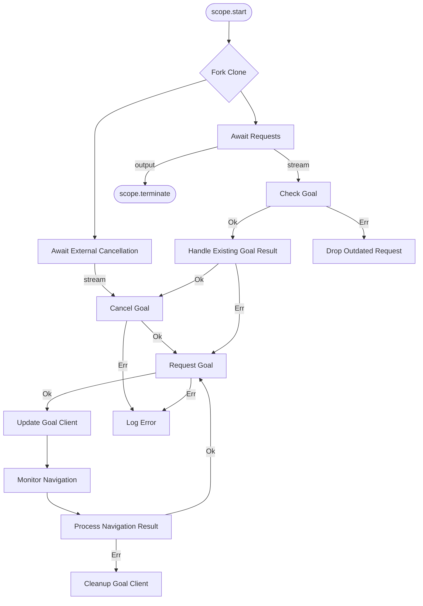
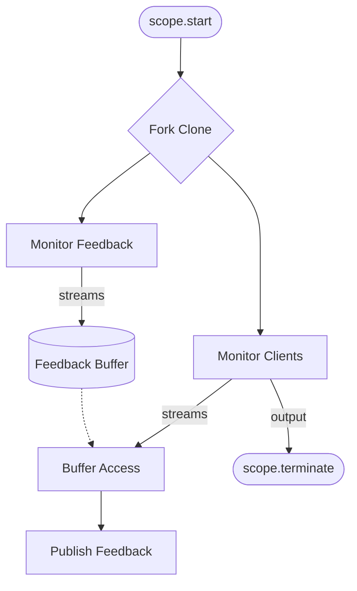

# Nav2 Integration Demo


This tutorial contains the various packages required for Nav2 integration and demonstrates how Next Gen prototype messages and traffic management design is used for multi-robot coordination. The core `rmf_nav2_traffic` plugin manages incoming navigation requests and plans produced by the path server, and publishes action goals to the Nav2 server accordingly. We also incorporate [spatio_temporal_partition_layer](https://github.com/arjo129/spatio_temporal_partitioning) into the `rmf_nav2_traffic` plugin, where safe zone data is used to update the Nav2 costmap and provide partitions to facilitate path-planning.

## InnerNavigationServices Workflow Diagram

This document describes the workflow in `InnerNavigationServices`, specifically the `await_and_send_goal` workflow, implemented using Crossflow.

### Workflow Diagram



### Node Descriptions

- **`await_new_requests`**: A continuous service that listens for `InnerNavigationTarget` events and streams `InnerNavigationRequest` objects.
- **`await_external_cancellation`**: A continuous service that listens for `CancelInnerForAgent` events and streams cancellation requests.
- **`check_existing_goal`**: Checks if the agent already has an active goal. If the incoming request is outdated/duplicate, it returns an error and gets dropped. Otherwise it returns ok.
- **`handle_existing_goal_result`**: Routes the valid checked result into either a cancellation of the current goal or a direct request for a new goal.
- **`async_cancel_goal`**: An asynchronous service that cancels the existing Nav2 goal.
- **`async_request_new_goal`**: An asynchronous service that sends a new `NavigateToPose` goal to Nav2.
- **`update_goal_client`**: Updates the `InnerNavigationClient` component with the new goal handle.
- **`async_monitor_ongoing_navigation`**: Monitors the progress of the navigation goal, handling feedback and final results (Succeeded, Aborted, Cancelled).
- **`process_navigation_result`**: Publishes `CODE_PATH_BLOCKED` for an aborted current goal and ignores results from superseded goals.
- **`cleanup_goal_client`**: Cleans up the goal client state in the component upon completion or failure.
- **`log_inner_navigation_error`**: Logs any errors encountered during goal cancellation or request.

An unchanged incremental target is resent when it belongs to a new plan, while cancellation or abort results from an older goal cannot trigger another replan.

## NavigationServices Workflow Diagram

This document describes the workflow in `NavigationServices`, implemented using Crossflow.

### Workflow Diagram



### Node Descriptions

- **`monitor_inner_navigation_clients`**: A continuous service that manages incoming navigation requests and responds to orders when the entire navigation is completed.
- **`monitor_inner_navigation_feedback`**: A continuous service that monitors feedback from inner navigation clients.
- **`FeedbackBuffer`**: A buffer that keeps the last 10 `InnerNavigationFeedback` items.
- **`Buffer Access`**: Accesses the `FeedbackBuffer` to retrieve feedback for requests coming from `monitor_inner_navigation_clients`.
- **`publish_navigation_feedback`**: A service that publishes the navigation feedback.

## Try out the demo

### Build

Build the docker image:

```bash
docker compose -f docker/docker-compose.yml build
```

### Run

Allow RViz GUI to display through docker containers:

```bash
xhost +local:docker 
```

Spin up the Nav2 simulation:

```bash
docker compose -f docker/docker-compose.yml up -d --force-recreate
```

To run headless, use the command below:

```bash
docker compose -f docker/docker-compose.yml -f docker/docker-compose.headless.override.yml up -d --force-recreate
```

To run monolithic using ZenohDDS, use the commmand below:

```bash
docker compose -f docker/docker-compose.yml -f docker/docker-compose.zenoh.override.yml up -d --force-recreate
```

Send action goals to the robots:

```bash
docker exec -it next_gen_prototype bash -c "source /nav2_traffic_ws/install/setup.bash && \
    ros2 action send_goal robot0/navigate_to_pose nav2_msgs/action/NavigateToPose \"{
      pose: {
        header: {
          stamp: {sec: 0, nanosec: 0},
          frame_id: 'map'
        },
        pose: {
          position: {x: 5.0, y: 5.0, z: 0.0},
          orientation: {x: 0.0, y: 0.0, z: 0.0, w: 1.0}
        }
      }
    }\"
"
```

```bash
docker exec -it next_gen_prototype bash -c "source /nav2_traffic_ws/install/setup.bash && \
    ros2 action send_goal robot1/navigate_to_pose nav2_msgs/action/NavigateToPose \"{
      pose: {
        header: {
          stamp: {sec: 0, nanosec: 0},
          frame_id: 'map'
        },
        pose: {
          position: {x: 0.0, y: 3.0, z: 0.0},
          orientation: {x: 0.0, y: 0.0, z: 0.0, w: 1.0}
        }
      }
    }\"
"
```

Alternate navigation goals:

```bash
docker exec -it next_gen_prototype bash -c "source /nav2_traffic_ws/install/setup.bash && \
    ros2 action send_goal robot0/navigate_to_pose nav2_msgs/action/NavigateToPose \"{
      pose: {
        header: {
          stamp: {sec: 0, nanosec: 0},
          frame_id: 'map'
        },
        pose: {
          position: {x: 9.0, y: 3.0, z: 0.0},
          orientation: {x: 0.0, y: 0.0, z: 0.0, w: 1.0}
        }
      }
    }\"
"
```

```bash
docker exec -it next_gen_prototype bash -c "source /nav2_traffic_ws/install/setup.bash && \
    ros2 action send_goal robot1/navigate_to_pose nav2_msgs/action/NavigateToPose \"{
      pose: {
        header: {
          stamp: {sec: 0, nanosec: 0},
          frame_id: 'map'
        },
        pose: {
          position: {x: 9.0, y: 6.0, z: 0.0},
          orientation: {x: 0.0, y: 0.0, z: 0.0, w: 1.0}
        }
      }
    }\"
"
```

:::{seealso}
Part of the **For Users** guide.
:::
